<div align="center">
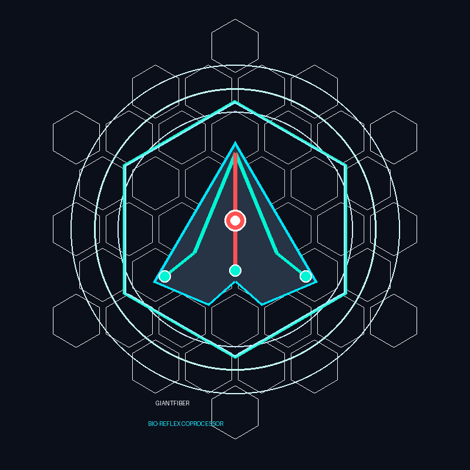

# GiantFiber (GF-1)

An event-camera looming-escape reflex modelled on the *Drosophila* Giant Fiber circuit, with
connectome-derived weights (FlyWire v783, MANC v1.2.1). It is a Rust core (std and `no_std`) with a
Python SDK, a PX4 offboard bridge, a CAN-FD frame and a Verilog prototype of the descending stage.

[](https://github.com/reacherwu/giant-fiber/actions/workflows/ci.yml)
</div>

> **Status: research prototype.** Everything below was measured in simulation: synthetic events
> and PX4 SITL. Nothing has been flown, run on real event-camera data, or measured on embedded
> hardware. In the final held-out PX4 SITL campaign (v4: an 8 mm plus 3x3 25 mm IMX636 rig with the
> far-field TTC stage), the reflex had 0 collisions in 66 trials at each of 6, 10, 14, 20 and 30 m/s
> (95% CI upper bound 5.5%), and 0 false triggers in 198 controls. It does **not** meet the bar at
> 60 m/s (7.6%), 90 m/s (4.5%, CI upper bound 12.5%) or 120 m/s (21.2%). See
> [the v4 results](#px4-sitl-campaign-v4-final-held-out-3x3-tiled-25-mm-imx636-rig-6120-ms).
> v1–v3 are kept as history.

---

## What it does

```
events (x, y, t, polarity)
  -> 64x64 time surface
  -> looming estimate: angular size θ, expansion rate dθ/dt, coherence / translation gates
  -> LPLC2 (size-tuned) and LC4 (velocity-tuned) population activity, left/right
  -> Giant Fiber (DNp01) and non-GF descending pathway leaky integrators
       weights = FlyWire v783 synapse-count fractions
  -> escape mode: LONG (non-GF crosses its threshold) or SHORT (GF spike; upgrades LONG within 30 ms)
  -> discrete action (roll away from the stimulus / pitch) + confidence gate
  -> PX4: acceleration setpoints (SET_POSITION_TARGET_LOCAL_NED), or a 24-byte CAN-FD frame
```

Biological basis and how far the model follows it:

| element | source | in the model |
|---|---|---|
| LPLC2 encodes angular size, LC4 angular velocity; both drive the GF | Ache et al. 2019; von Reyn et al. 2017 | activation functions (sigmoid in θ, saturating in dθ/dt); half-activation points are parameters |
| LPLC2/LC4 → DNp01 synapse counts, per hemisphere | FlyWire v783 (Dorkenwald et al. 2024; Schlegel et al. 2024) | real root IDs and counts in `data/connectome/`, normalised per target as weights |
| parallel non-GF descending pathway with a lower threshold → long-mode takeoff; GF spike → short mode | von Reyn et al. 2014 | top-8 non-GF DN types by LPLC2+LC4 input (our selection rule); thresholds 0.30 vs 0.55 |
| GF → TTMn / PSI → DLMn | MANC v1.2.1 (Takemura, Marin, Cheong et al. 2024) | tabulated (`manc121_gf_motor_edges.csv`), not simulated; GF→TTMn is largely electrical and EM counts miss gap junctions |
| heading-hold "central complex" | — | a plain heading integrator, **not** connectome-derived |

Time constants, thresholds and activation shapes are modelling choices, not fits to electrophysiology.
The connectome data were extracted with `tools/connectome/extract_escape_circuit.py`; see
[data/connectome/README.md](data/connectome/README.md) for sources and the CC-BY 4.0 license.

## Model validation (synthetic stimuli)

`python3 tools/validation/validate_escape_model.py --out docs/model` (0.15 m sphere, 90° camera,
geometric event synthesis, 5 seeds per condition):

| r/v (ms) | mean θ at GF spike | GF spike before contact | reached short mode | long mode only |
|---|---|---|---|---|
| 5  | 26.4° | 16.9 ms  | 5/5 | 0/5 |
| 10 | 24.6° | 36.9 ms  | 5/5 | 0/5 |
| 20 | 25.0° | 72.4 ms  | 5/5 | 0/5 |
| 40 | 26.9° | 132.4 ms | 3/5 | 2/5 |
| 80 | 32.8° | 204.2 ms | 0/5 | 5/5 |

- The GF spike time before contact is linear in r/v (2.47·r/v + 16.0 ms, r = 0.980), the signature of a
  size threshold.
- Fast looms end in short mode and slow looms in long mode. This is the qualitative split from von Reyn 2014.
- Receding, lateral, static and noise-only stimuli (0.1–3 Hz/px) gave 0/35 escapes.

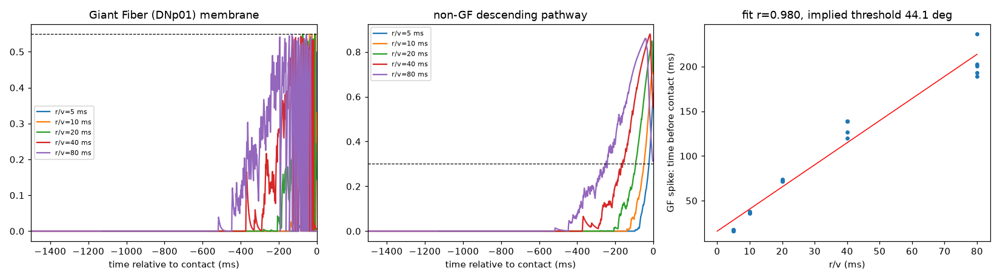

## PX4 SITL campaign v4 (final held-out: 3x3 tiled 25 mm IMX636 rig, 6–120 m/s)

**Rig (`tiled9`).** One 8 mm IMX636 camera (42.5° HFOV) for the near field, plus a 3x3 grid of 25 mm
IMX636 tiles (14.2° x 8.0° each, at yaw −12/0/+12° and pitch −7/0/+7°). The grid covers ±19.1° x
±11.0° at 25 mm resolution, which is the whole threat cone (±15° x ±8°) with margin. Every tile has
its own derotation and its own far-field tracker, and any tile can arm.

The v3 tiled rig had only two pitch rows (±3.5°), so it lost objects beyond about ±5.5° elevation. In
v3, most of its collisions were in that band.

**Hardware plausibility (estimates, not measured):**
- CenturyArks SilkyEvCam HD is a board-level IMX636 module with MIPI output: 12 g without lens, about
  0.26 W average (80 mA at 3.3 V). Ten modules with M12 lenses come to roughly 200 g, plus the mount
  and about 3 W.
- No module price is published. The Prophesee EVK4 HD evaluation camera costs US$5,450, so ten of those
  would be about US$55k.
- Ten 2-lane MIPI streams need a SoC with CSI aggregation.
- This is purchasable, but it is a heavy, expensive payload, suited to a larger airframe rather than a
  small quad.

**Method.**
- The far-field config is the v3 frozen config, unchanged.
- Stricter miss and confirm gates were tested on dev seeds: miss < 4 or 5 radii, and 25 or 40
  consecutive confirmations. They were rejected because they stopped arming on dev threats (for
  example, 120 m/s armed in only 6 of 16 dev trials with confirm 40).
- The v3 flyby false trigger (u2-0048) started while the vehicle was still moving from the previous
  escape (`settled=0`). v4 waits up to 60 s for the vehicle to settle, and 91.6% of trials started
  settled.
- Seeds 2001–2006 are new. Six PX4 instances ran with `SIM_BAT_MIN_PCT=100`. The run was a single
  campaign with no restarts.

### Results (reflex arm, Wilson 95% CI)

| Speed | n | Collisions | Rate [95% CI] | Baseline | Median TTC at trigger | Bar met? |
|---|---|---|---|---|---|---|
| 6 m/s | 66 | 0 | 0.0% [0.0, 5.5] | 0/6 | 1263 ms | yes |
| 10 m/s | 66 | 0 | 0.0% [0.0, 5.5] | 5/6 | 937 ms | yes |
| 14 m/s | 66 | 0 | 0.0% [0.0, 5.5] | 6/6 | 932 ms | yes |
| 20 m/s | 66 | 0 | 0.0% [0.0, 5.5] | 6/6 | 819 ms | yes |
| 30 m/s | 66 | 0 | 0.0% [0.0, 5.5] | 5/6 | 935 ms | yes |
| 60 m/s | 66 | 5 | 7.6% [3.3, 16.5] | 6/6 | 871 ms | no |
| 90 m/s | 66 | 3 | 4.5% [1.6, 12.5] | 6/6 | 648 ms | no (rate meets ≤5%; CI upper bound does not) |
| 120 m/s | 66 | 14 | 21.2% [13.1, 32.5] | 5/6 | 492 ms | no |

**False triggers:** 0/66 hover, 0/66 sensor noise, 0/66 flyby. This meets the bar.

**Measured envelope (60–120 m/s reflex trials, collisions by TTC at trigger):**

| TTC at trigger | Collisions / trials |
|---|---|
| not armed | 6/10 |
| < 300 ms | 10/11 |
| 300–400 ms | 4/14 |
| 400–500 ms | 2/22 |
| ≥ 500 ms | **0/141** |

Escaping requires arming at least about 0.5 s before contact, which means about 60 m at 120 m/s. The
rig reaches that at 60 and 90 m/s in most trials. At 120 m/s it reaches it in about half: the median
TTC at trigger is 492 ms, and the 10th percentile trigger distance is 39.8 m. The limit is how early
the 1/r regression gets a significant expansion signal: about 6 px radius and a few px/s of growth at
100 m. Escape dynamics are not the limit. Meeting 120 m/s would need longer focal lengths, which means
roughly 4x more tiles for the same cone, or a higher-resolution sensor than any event sensor on sale
today.

### Disclosures
- **Battery-failsafe exclusion rule fixed.** In v4, the `landed_cutoff` rule from v3 wrongly flagged
  shard x0: normal hover jitter produced five small monotone rises. The rule now also requires a total
  rise greater than 1 m. x0 never descended (every start altitude was 10.4–12.5 m), so v4 excludes no
  trials. The v3 exclusions are unchanged (s0: 26, s1: 23).
- **Loop-rate stalls.** A few trials had loop-rate stalls: x4-0104 ran at 2.2 Hz, x1-0102 at 15 Hz, and
  x3-0121 at 36.6 Hz, all from host CPU contention with six instances. They are kept in the data. None
  of the stalled threat trials was a reflex collision.
- **Rig choice after v3.** The rig was changed after the v3 results. It was chosen from dev seeds (dev:
  96/96 threats armed at 30–120 m/s, minimum TTC 0.46 s, 0/180 flyby arms) and evaluated once here.

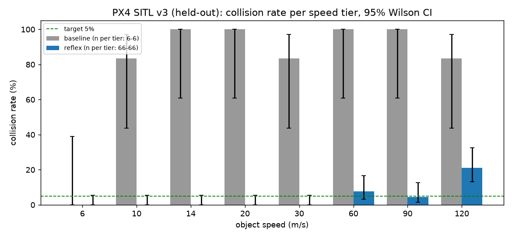
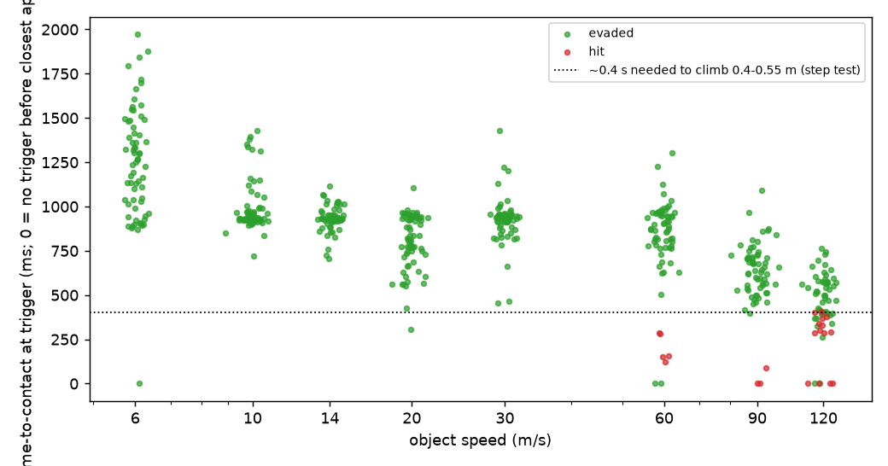

| 60 m/s evasion | 120 m/s hit |
|---|---|
|  |  |

## PX4 SITL campaign v3 (held-out: IMX636 camera + far-field TTC stage, history)

**Setup.** Simulated Prophesee IMX636 sensor (1280x720, 4.86 µm pixels, contrast threshold, 1 ms
refractory period, 0.1 Hz/px background activity, 2 ms latency). Two rigs:
- **dual**: one 8 mm lens (42.5° HFOV) plus one 25 mm lens on axis.
- **tiled**: one 8 mm lens plus six 25 mm lenses (yaw −12/0/+12°, pitch ±3.5°). This rig was chosen on
  dev seeds and evaluated only on the 30–120 m/s tiers.

A far-field TTC stage (`farfield.rs`) arms a thrust-axis escape (20 m/s², 1.2 s). It uses block
clustering, a circle fit, a 1/r regression for tau and a miss-distance prediction, on derotated events.
The connectome GF stage stays as the near-field trigger, gated by a far-field track. A 2 ms
background-activity filter runs on the GF input. Collisions are tested by segment closest approach
against a 0.40 m radius. Objects start 80–150 m away at the 30–120 m/s tiers. The control loop ran at
a median of about 470 Hz, and compute took a median of 93–143 µs per step.

All thresholds were frozen on dev seeds (<10000) before these runs. The seeds used here (404–1616)
were never used for tuning.

### Results (collision rate, Wilson 95% CI)

| Speed | Rig | Reflex n | Reflex collisions | Rate [95% CI] | Baseline | Median TTC at trigger | Meets bar (≤5%, upper ≤10%)? |
|---|---|---|---|---|---|---|---|
| 6 m/s | dual | 82 | 0 | 0.0% [0.0, 4.5] | 6/13 | 1118 ms | **yes** |
| 10 m/s | dual | 84 | 0 | 0.0% [0.0, 4.4] | 12/13 | 923 ms | **yes** |
| 14 m/s | dual | 87 | 0 | 0.0% [0.0, 4.2] | 10/14 | 873 ms | **yes** |
| 20 m/s | dual | 79 | 0 | 0.0% [0.0, 4.6] | 16/16 | 681 ms | **yes** |
| 30 m/s | dual | 65 | 6 | 9.2% [4.3, 18.7] | 12/12 | 508 ms | no |
| 30 m/s | tiled | 60 | 3 | 5.0% [1.7, 13.7] | 4/6 | 935 ms | no (upper bound) |
| 60 m/s | dual | 65 | 36 | 55.4% [43.3, 66.8] | 8/12 | 221 ms | no |
| 60 m/s | tiled | 60 | 5 | 8.3% [3.6, 18.1] | 5/6 | 854 ms | no |
| 90 m/s | dual | 63 | 51 | 81.0% [69.6, 88.8] | 8/8 | 91 ms | no |
| 90 m/s | tiled | 60 | 8 | 13.3% [6.9, 24.2] | 3/6 | 670 ms | no |
| 120 m/s | dual | 64 | 50 | 78.1% [66.6, 86.5] | 11/11 | 77 ms | no |
| 120 m/s | tiled | 60 | 15 | 25.0% [15.8, 37.2] | 6/6 | 449 ms | no |

The baseline arms run the same detection with no escape, so they show how many draws were on a
collision course. Every collision in the reflex arms at ≥30 m/s happened with the object
**outside the central 25 mm field of view**: 0 collisions among the in-FOV approaches. The limit is
angular resolution off-axis, not vehicle dynamics. With ~0.9 s of lead time the quad climbs well past
the 0.40 m radius.

**False triggers (no-threat controls).**
- **dual:** 0/77 hover, 0/81 sensor noise, 0/81 flyby.
- **tiled:** 0/60 hover, 0/60 noise, **1/60 flyby**. That flyby was at 60 m/s with a 2.68 m miss
  distance, and it triggered 1.44 s before closest approach. The tiled rig therefore does not meet the
  0-false-trigger bar.

### Disclosures
- **Aborted run 1.** The first launch of the final campaign (82 trials) was stopped because the GF stage
  false-triggered on 5 of 10 no-object hover trials. The fix was the background-activity filter plus the
  far-field gate on GF. The campaign was then relaunched with new seeds, and run 1 is not counted above.
- **Battery failsafe exclusion.** In run 2, shards s0 and s1 hit PX4's simulated battery failsafe, and
  the vehicle landed. Trials from one before the detected landing onward were excluded: 26 from s0 and
  23 from s1. The `landed_cutoff` function in `analyze_v3.py` does this. Top-up shards t0–t2 and w3–w5
  then ran with `SIM_BAT_MIN_PCT=100`.
- **Rig choice.** The tiled rig was introduced after the dual-rig results at 60–120 m/s were seen. It was
  selected on dev seeds and then evaluated once on fresh seeds (u0–u2). It was not tuned on these trials.

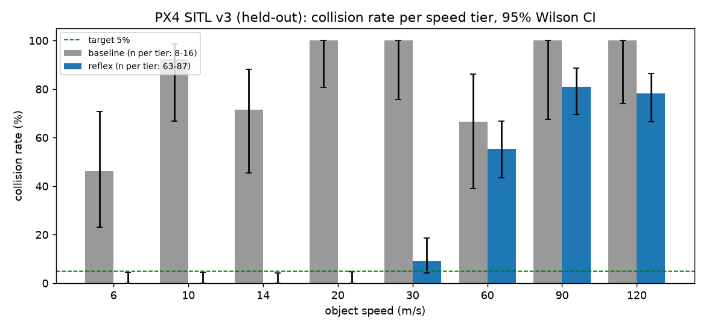
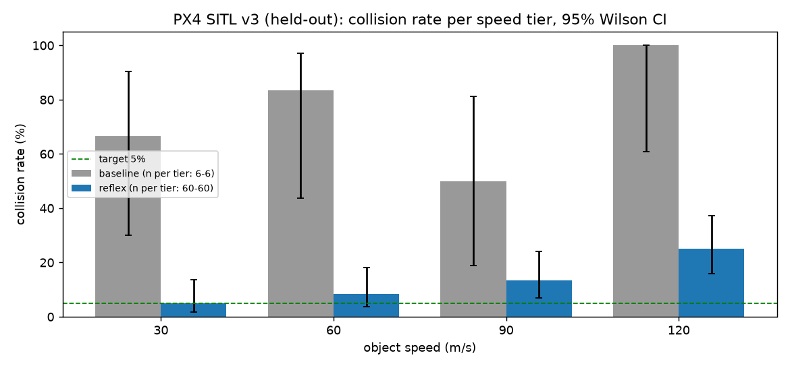
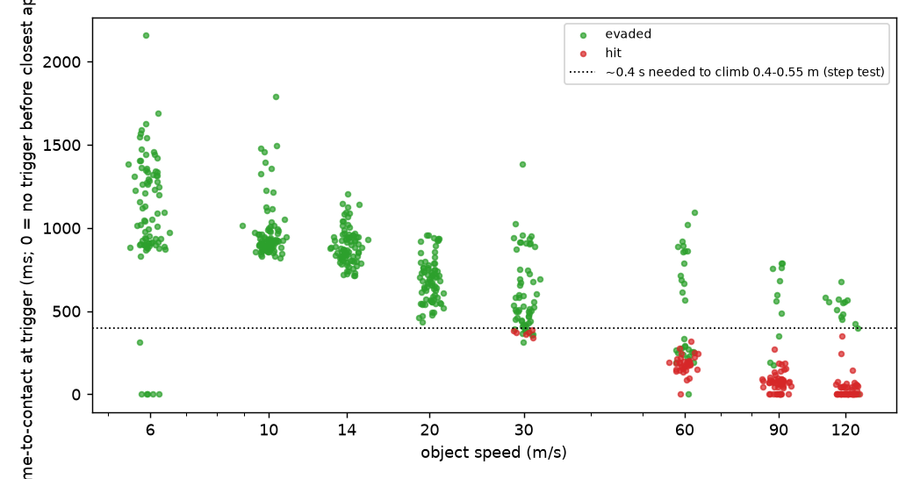

Footage from the reflex and baseline arms:

| 10 m/s evasion | 10 m/s baseline hit | 60 m/s evasion (tiled) | 120 m/s hit (tiled) |
|---|---|---|---|
| 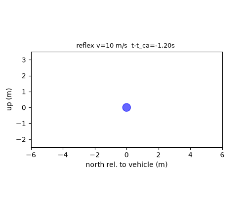 | 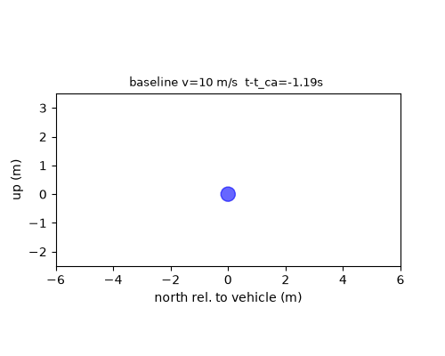 |  |  |

**Safe envelope (measured).**
- **6–20 m/s:** meets the bar with the dual rig, for the sampled object sizes and approach angles.
- **30 m/s:** borderline.
- **60–120 m/s:** dodged reliably only inside the narrow high-resolution FOV. Off-axis, the trigger
  comes later for some draws (p10 TTC at trigger 270–500 ms on the tiled rig). Those late draws are
  near or below the ~0.35–0.4 s the climb needs, and they are where the collisions occur.

Wider coverage at 25 mm-class resolution, meaning more tiles or a higher-resolution sensor, is the
remaining lever. Tuning the escape is not.

## PX4 SITL campaign v2 (detection range + escape tuning, history)

Same SITL setup, geometry and collision test as the first campaign below. 256 trials,
2026-10-19 17:03 to about 18:35 PDT, `docs/sim_v2/`. Command:
`run_campaign.py --arms reflex:drone2v:3,reflex:drone2:1,baseline:drone2v:2 --controls 20 --control-cfg drone2v --seed 2 --out docs/sim_v2`.

**What changed (commit 3be046b).**
- *Slow-edge channel* in the looming estimator. At long range the disk edge moves well under one
  cell per ms, so the 4 ms / ≥2-event rule found almost no edge cells. When the fast channel finds
  fewer than 3 cells, a fallback uses cells with ≥3 events in a 32 ms window (with the same
  8-neighbour noise filter).
- *Lower thresholds* (preset `drone2`: LPLC2 half-size 1.5°, LC4 half-velocity 5°/s). These were
  chosen offline on head-on synthetic approaches, not on the SITL geometries.
- *Thrust-axis escape* (preset `drone2v`, `escape_policy="vertical"`, held 0.8 s). In a PX4 SITL
  step-response test (`docs/sim_v2/step_response.json`, 2 repeats per command), climbing moved the
  vehicle 0.20–0.31 m in 0.3 s, against 0.05–0.10 m for a sideways command. Lateral moves have to
  tilt the vehicle first. Asking for more than 9 m/s² barely helped, because the vehicle saturates.
- An experimental `grid128` feature (128×128 surface) did **not** extend the range offline at the
  same camera resolution, so the campaign uses 64×64. One test fails under it, and it is not in CI.

| arm | trials | collisions | collision rate [95% CI] | triggered | median trigger distance | median TTC at trigger | median response |
|---|---|---|---|---|---|---|---|
| no reflex (baseline) | 72 | 53 | **73.6%** [62.4, 82.4] | 70 | 2.72 m | 253 ms | – |
| v2 detection, lateral escape | 36 | 21 | 58.3% [42.2, 72.9] | 34 | 2.67 m | 235 ms | 186 ms |
| v2 detection, vertical escape | 108 | 60 | **55.6%** [46.2, 64.6] | 102 | 2.79 m | 257 ms | **73 ms** |

| speed | baseline | vertical escape |
|---|---|---|
| 6 m/s | 14/24 (58%) | 8/36 (22%) [12, 38] |
| 10 m/s | 16/24 (67%) | 21/36 (58%) |
| 14 m/s | 23/24 (96%) | 31/36 (86%) |

Controls: 0/20 false triggers on 8 s hovers with no object, and 0/20 on fly-bys.

**Reading the result honestly.**
- Overall the drop is 18 points (two-proportion z ≈ 2.4). The 95% CIs still overlap slightly
  (64.6% vs 62.4%), so this is a clear drop but not a non-overlapping one. At 6 m/s the CIs do not overlap.
- Detection range went from 2.11 m (v1 drone preset) to 2.79 m median (TTC 168 → 257 ms).
- The bigger gain came from the actuation side: switching to a thrust-axis escape cut the response
  from 186 to 73 ms.
- **Physical limit.** Clearing the 0.40 m hit radius takes about 0.35–0.4 s even when climbing
  (step test). At 14 m/s the median trigger is only about 160 ms before contact. Getting there would
  need detection at about 5.5 m, i.e. roughly twice the current range. With this sensor model
  (320 px, 60° FOV, 0.30 m object), the expansion at that distance is below about one pixel per
  30 ms. Getting there needs a higher-resolution or narrower-FOV sensor, or a cue other than
  expansion. It is not a parameter-tuning problem.
- Held-out protocol: the thresholds were chosen on offline head-on runs and the escape on the step
  test. Neither was tuned on these campaign trials, and this campaign was run once.

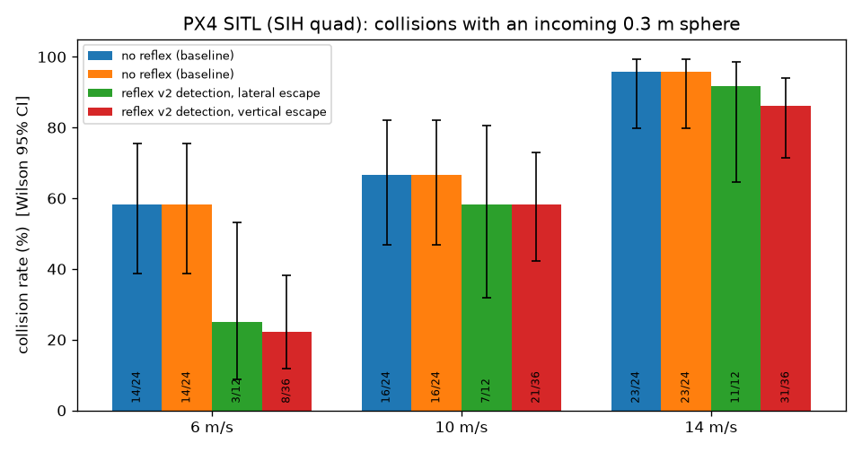

## PX4 SITL incoming-object campaign (v1, history)

**Setup.**
- PX4 v1.15.4, SIH quadrotor (`sihsim_quadx`), headless, real-time, offboard mode, hovering at 10 m.
- A 0.30 m sphere is launched at constant speed (6, 10 or 14 m/s) from 15 or 25 m. Azimuth is −15/0/+15°
  and elevation 0/8°. It is aimed at the vehicle's launch position with ≤ 0.1 m aim error.
- Events are synthesised at about 480 Hz from the object geometry and the vehicle's ground-truth pose
  (HIL_STATE_QUATERNION): XOR occupancy changes of the projected disk on a 320×320 camera, plus
  0.3 Hz/px Poisson noise. There is no texture, no DVS pixel model and no motion blur.
- Collision means the minimum centre distance is < 0.40 m (object radius 0.15 m + vehicle radius 0.25 m),
  from ground truth.

**Arms.**
- *Baseline*: the engine runs, but nothing is sent and the vehicle keeps hovering.
- *Reflex (drone preset)*: 60° FOV, LPLC2 half-size 4°, LC4 half-velocity 20°/s. On an escape it streams
  9 m/s² (short mode) or 5 m/s² (long mode) acceleration setpoints sideways or vertically for 0.5 s, then
  holds position.
- *Reflex (fly preset)*: the default fly-scale thresholds with a 90° FOV.
- *Legacy*: the original single SET_ATTITUDE_TARGET packet.
- Controls: 30 × 8 s hover with no object, and 30 fly-bys that miss by 2.5–3.7 m.

The campaign ran 312 trials from 2026-10-19 08:17 to 09:54 PDT on the machine listed below.
Reproduce it with `bash sim/px4_sitl/run_all.sh`.

| arm | trials | collisions | collision rate [95% CI] | escape triggered | median trigger distance | median time-to-contact at trigger |
|---|---|---|---|---|---|---|
| no reflex (baseline) | 72 | 54 | **75.0%** [63.9, 83.6] | 61 (85%) | 1.81 m | 146 ms |
| reflex, drone preset | 108 | 85 | **78.7%** [70.1, 85.4] | 99 (92%) | 2.11 m | 168 ms |
| reflex, fly preset | 36 | 25 | 69.4% [53.1, 82.0] | 20 (56%) | 0.79 m | 31 ms |
| legacy attitude packet | 36 | 31 | 86.1% [71.3, 93.9] | 33 (92%) | 2.02 m | 154 ms |

| control | trials | false triggers |
|---|---|---|
| hover, no object (240 s total) | 30 | 0 (95% CI upper bound 11%) |
| fly-by, 2.5–3.7 m miss | 30 | 0 (95% CI upper bound 11%) |

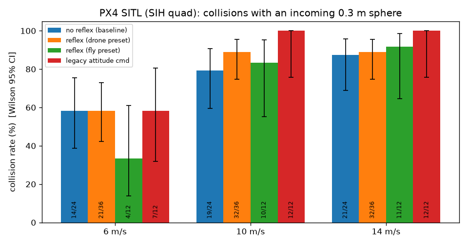

**Finding: the reflex detects the threat, but too late for this vehicle to get out of the way.**
- With the drone preset the escape triggers at a median of 2.1 m (168 ms before contact).
- The vehicle's measured response is too slow for that margin. The time from trigger until its
  ground-truth velocity changes by 0.2 m/s along the escape direction has a median of **186 ms**
  (p5–p95 167–216 ms, n = 99).
- In PX4's own log (121 acceleration-setpoint episodes in the ulog), the vehicle moved a median of
  0.54 m along the commanded direction 0.5 s after the first *logged* setpoint. The setpoint topic is
  logged at 10 Hz.
- So for most trials the vehicle has barely moved at closest approach. The collision rate with the
  reflex is statistically indistinguishable from the baseline: 78.7% vs 75.0%, overlapping CIs.
- The fly preset fires even later (median 31 ms before contact), matching the fly-scale angular thresholds.
- The single-packet legacy command is overridden by the next offboard setpoint and has no effect.
- The baseline does not hit 100% because the hover drifts by a few tenths of a metre during the
  object's 1–4 s flight.

The bottleneck is detection range, not compute:
- Compute per step is 6 µs median.
- Trigger to setpoint sent takes 183 µs median, including the MAVLink encode and UDP send.
- The 64×64 internal time surface needs the object to cover several cells. In an offline check
  (`python3 tools/validation/detection_range.py`, 6 head-on runs per setting, 0.3 m object):
  - the SITL drone preset triggered at 1.6–2.6 m;
  - lowering the thresholds gave 1.9–3.5 m (mostly about 2.6 m);
  - a 30° FOV gave 2.9–4.0 m;
  - none of these settings triggered on the 6 fly-bys.
- Making this useful for a quadrotor needs earlier detection (a higher-resolution surface or a
  narrower FOV), a faster actuation path, or both. These are open items.

Ground-truth trajectories (view from behind the vehicle; circles mark the closest approach):

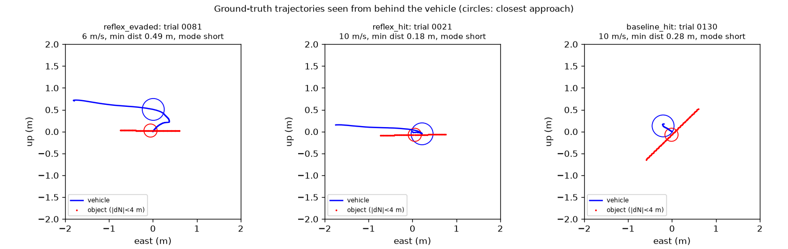

| reflex trial that evaded (6 m/s) | baseline trial that was hit (10 m/s) |
|---|---|
| 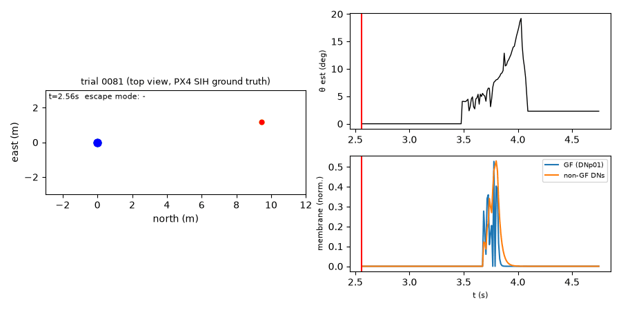 | 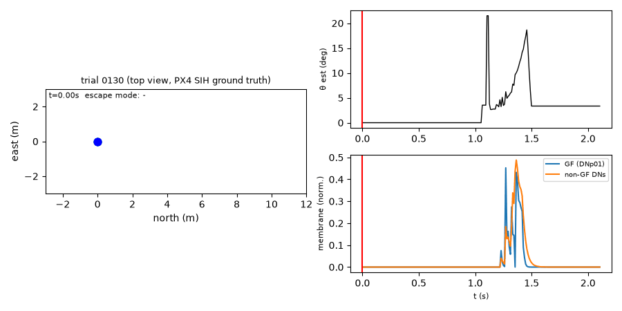 |

The animations are rendered from the logged ground truth (top view) with the engine's internal state.
They are not camera footage.

Vehicle response from the PX4 ulog (one line per escape episode, aligned to the first logged
acceleration setpoint). A few episodes show motion opposite to the averaged setpoint. These were not investigated
individually; a likely cause is that the analysis merges setpoints less than 2 s apart, so it can
combine two escape commands with different directions into one episode. The analysis found 121
episodes in the ulog against 119 reflex trials that triggered.

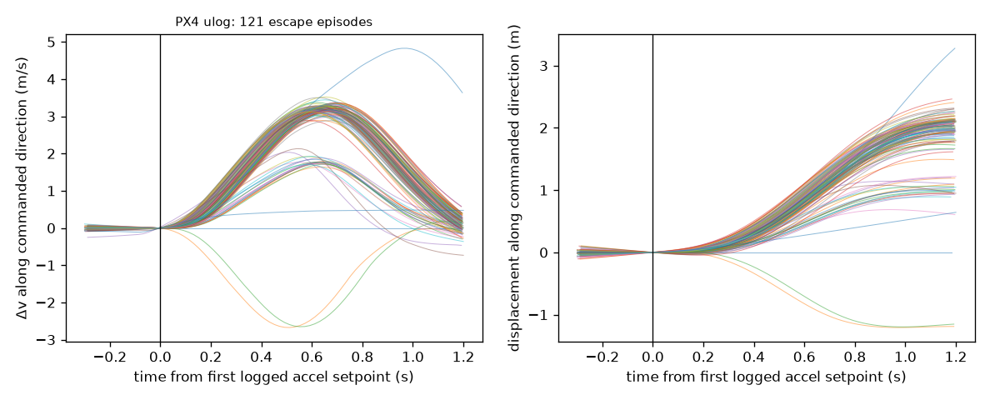

Data:
- `docs/sim/trials.csv`: one row per trial.
- `docs/sim/traces/*.csv.gz`: 100 Hz traces per trial.
- `docs/sim/summary.json` and `summary_by_speed.csv`
- `docs/sim/ulog_escape_episodes.csv`
- `docs/sim/campaign_meta.json`

The 1.3 GB ulog is not committed. `sim/px4_sitl/analyze.py --ulog <file>` regenerates the plots
from a new run.

## Benchmarks

`python3 benchmarks/run_benchmarks.py --json benchmarks/results.json` on an Intel Xeon (8 vCPU)
cloud VM running Linux 6.12, with Python 3.13.5 and rustc 1.99.1. All figures were measured in that
run (see `benchmarks/results.json`):

| measurement | result |
|---|---|
| native `step_eval` (Rust, looming stimulus, 56,100 steps) | mean 1.72 µs, p99 5.88 µs, max 34 µs |
| native event ingestion | 141 M events/s |
| Python → C ABI round trip (feed + step + pydantic object) | median 7.7 µs, p99 96 µs |
| event ingestion through the C ABI | 31.5 M events/s |
| snapshot save / restore (280 bytes) | 0.80 µs / 0.76 µs |
| MAVLink SET_POSITION_TARGET_LOCAL_NED encode (Python) | 11.7 µs |
| CAN-FD encode + decode (Python) | 28.3 µs |
| EVT2 decode (Python) | 1.59 M events/s |
| false triggers, 60 s of 1 Hz/px noise | 0 |

These are desktop-CPU numbers. They say nothing about a microcontroller, and no power was measured.

## Components

| path | what |
|---|---|
| `crates/giantfiber-core` | Rust engine. `cargo build --no-default-features --features libm --target thumbv7em-none-eabihf` builds `no_std` (checked in CI); the C ABI (`ffi.rs`) needs `std` |
| `giantfiber/` | Python SDK (ctypes), PX4 bridge (`integrations/px4_mavlink.py`), CAN-FD + SocketCAN (`integrations/can_fd.py`), Prophesee EVT2/EVT3 decoders, event synthesis (`sim/events.py`) |
| `crates/.../canfd.rs` | `no_std` 24-byte CAN-FD frame, byte-identical to the Python codec (tested). The SocketCAN loopback test passes on a `vcan0` interface in CI; it has not been tested on physical CAN hardware |
| `rtl/` | Verilog prototype of the GF/non-GF stage. In Icarus Verilog it matches the Rust engine on 10/11 stimuli exactly and on 1 within one step. Simulation only, not synthesised ([rtl/README.md](rtl/README.md)) |
| `tools/connectome` | connectome extraction (FlyWire v783, MANC v1.2.1) |
| `tools/validation` | model validation on synthetic looms |
| `sim/px4_sitl` | SITL campaign, analysis, one-command reproduction |

The EVT2/EVT3 decoders follow the published Prophesee word formats. They have only been tested on
synthetic words, not on recordings from a real sensor.

## Quick start

```bash
cargo build --release
pip install -r requirements-dev.txt
cargo test && python3 -m pytest tests -q
python3 examples/looming_demo.py          # prints θ, membranes and the escape decision for a loom
```

```python
from giantfiber import GiantFiberCoprocessor, ReflexConfig
with GiantFiberCoprocessor(ReflexConfig()) as gf:
    gf.feed_raw_spikes(buf)        # numpy array of giantfiber.sim.events.EVENT_DTYPE, .tobytes()
    d = gf.step_eval(now_us)       # ReflexDecision: action, escape_mode, vector, confidence, triggered
```

PX4 (SITL or companion computer, offboard mode):
`PX4ReflexBridge(PX4BridgeConfig()).step_eval(t_us)` starts an escape on a decision.
`evasion_packet()` returns the acceleration setpoint to stream while `evasion_active()` is true.
See `sim/px4_sitl/run_campaign.py` for a complete loop.

Make targets: `test`, `clippy`, `nostd`, `bench`, `validate`, `rtl`, `connectome`, `sitl`.

## Roadmap

Done in software:
- connectome-derived model
- `no_std` core
- PX4 offboard bridge tested in SITL
- CAN-FD frame and SocketCAN transport
- RTL prototype of the descending stage

Planned / not started:
- detection range for drone-scale use (higher-resolution time surface)
- validation on real event-camera recordings
- hardware-in-the-loop and flight tests
- embedded timing and power measurements
- RTL for the front end, synthesis and FPGA

## References

- Ache, J. M. et al. (2019) Neural basis for looming size and velocity encoding in the *Drosophila* giant fiber escape pathway. *Curr. Biol.* 29.
- von Reyn, C. R. et al. (2014) A spike-timing mechanism for action selection. *Nat. Neurosci.* 17.
- von Reyn, C. R. et al. (2017) Feature integration drives probabilistic behavior in the *Drosophila* escape response. *Neuron* 94.
- Klapoetke, N. C. et al. (2017) Ultra-selective looming detection from radial motion opponency. *Nature* 551.
- Card, G. & Dickinson, M. H. (2008) Visually mediated motor planning in the escape response of *Drosophila*. *Curr. Biol.* 18.
- Dombrovski, M. et al. (2023) Synaptic gradients transform object location to action. *Nature* 613.
- Dorkenwald, S. et al. (2024) Neuronal wiring diagram of an adult brain. *Nature* 634.
- Schlegel, P. et al. (2024) Whole-brain annotation and multi-connectome cell typing of *Drosophila*. *Nature* 634.
- Takemura, S. et al.; Marin, E. C. et al.; Cheong, H. S. J. et al. (2024) Male adult nerve cord (MANC) papers. *eLife*.

## License

Code: Apache-2.0 ([LICENSE](LICENSE)). Connectome-derived tables in `data/connectome/`: CC-BY 4.0,
from FlyWire and MANC (cite the papers above). PX4, Pixhawk and MAVLink are trademarks of their
respective owners. This project is not affiliated with them.
